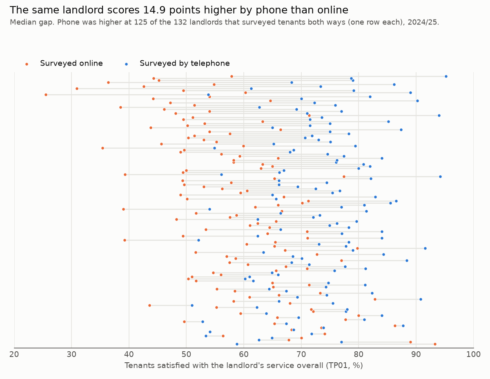
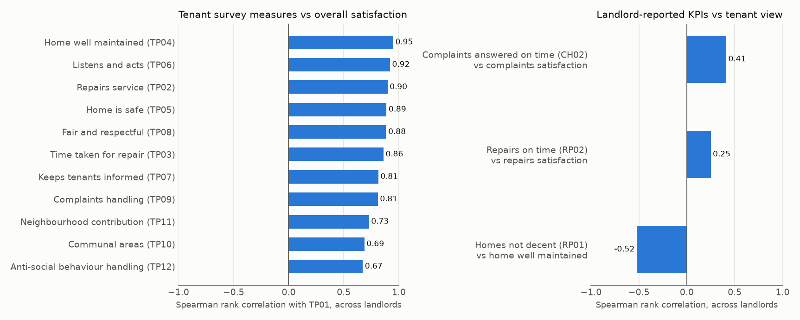
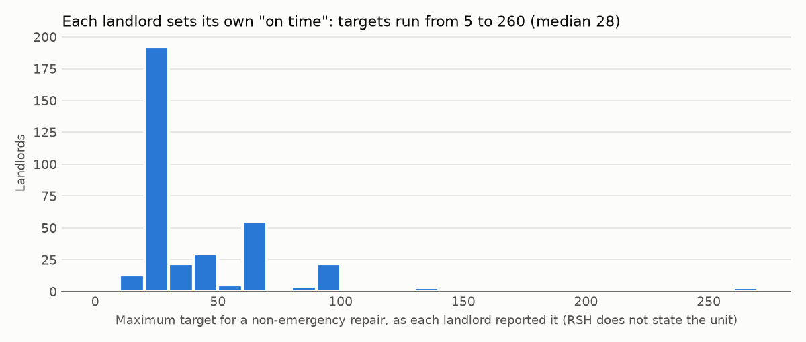
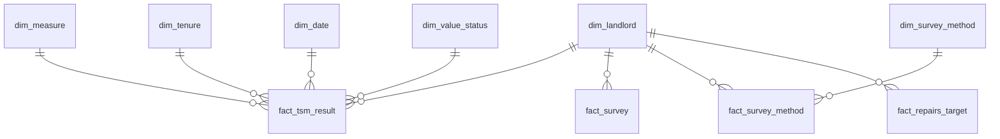

# Social Housing Tenant Satisfaction: Benchmarking What the Numbers Can Bear

[](https://github.com/tellnoone/uk-homelessness-bi/actions/workflows/reproduce.yml)

Every large social landlord in England now publishes Tenant Satisfaction
Measures (TSMs), and boards compare themselves against them. This project
asks **which of those comparisons are fair**, using the Regulator of Social
Housing's 2024/25 data for 363 landlords.

**Overall satisfaction depends heavily on how the survey was run.** Where a
landlord surveyed tenants both by phone and online, the phone results were a
median **14.9 points higher**. That is about the size of the gap between the median London
and North landlord (15.4 points). A landlord's own repairs KPI ("repairs done
on time") hardly moves with what tenants say about repairs (rank correlation
**0.25**), and each landlord measures it against its own target, anywhere
from 5 to 260.

**What a housing provider should do with this:**

1. **Benchmark satisfaction against landlords that surveyed the same way**,
   not against the national table. Of the 18 online-surveyed landlords in the
   bottom quartile nationally, **7 are not in the bottom quartile of other
   online-surveyed landlords**.
2. **Before changing survey method, expect the score to move**, and tell the
   board why. Moving from phone to online would likely cost points that have
   nothing to do with service.
3. **Do not report "repairs completed within target" as evidence of repairs
   performance** without the target beside it. Report time to complete on one
   fixed definition instead.
4. **Look at home condition first.** Of the tenant survey measures, "home
   well maintained" ranks landlords most like overall satisfaction does (rank
   correlation **0.95**), and it is the one tenants' view that a landlord KPI
   clearly tracks: the share of homes failing the Decent Homes Standard runs
   against it at **-0.52**. These are comparisons between landlords, not proof
   of cause; see [Limitations](#limitations).

This is also a BI project: a DuckDB warehouse with a star schema built in SQL,
a data quality layer with published results, and a Power BI model with
documented DAX. [Jump to the model](#the-model) or
[the data quality results](#data-quality).

---

## Results

| | |
|---|---|
| Landlords in RSH's release | 363 |
| Landlords with a rented-tenant survey | 353 |
| Median overall satisfaction (TP01) | **71.8%** (middle half 64.7-78.9%) |
| Housing associations vs councils (median TP01) | 75.4% vs 68.5% |
| North vs London (median TP01) | 76.6% vs 61.2% |
| Same landlord, phone minus online (median, 132 landlords) | **+14.9 points** |
| Landlords where phone scored higher | 125 of 132 (94.7%) |
| Repairs on time (RP02) vs repairs satisfaction (TP02), rank correlation | **0.25** |
| Landlords using more than one repair target | 282 of 356 (79.2%) |
| Data quality checks | 19 run over 62,083 rows: 14 passed, 5 warnings, 0 blocking |

All figures are for tenants in rented social housing (LCRA) unless stated,
and use each landlord's published value.

## Finding 1: survey method changes the score



132 landlords surveyed rented tenants both by telephone and online, and RSH
publishes overall satisfaction for each method separately. At the same
landlord, telephone respondents were more satisfied at **125 of 132** (94.7%).
The median gap was **14.9 points** (middle half 10.0-19.7). Limiting to the 107
landlords with at least 100 responses each way gives 14.7 points, so small
samples are not what drives it.

This comparison holds the landlord, its homes and its service fixed. What it
cannot separate is *why* the methods differ: people may answer an interviewer
more positively, or the tenants who answer the phone may be more satisfied
than those who answer online. For benchmarking it doesn't matter which. The
published number depends on the method mix either way.

**What it does to a league table.** Among the 286 landlords whose survey was
mainly telephone or mainly online, online-surveyed landlords had a median
TP01 of 67.9% against 71.7% for telephone. 18 of the 44 online-surveyed
landlords fall in the national bottom quartile (against 55 of 242 telephone).
Ranked only against other online-surveyed landlords, **7 of those 18 are no
longer in the bottom quartile.**

## Finding 2: what moves with overall satisfaction



Left: across landlords, "home well maintained" (TP04, **0.95**), "listens and
acts" (TP06, 0.92) and the repairs service (TP02, 0.90) rank landlords most
like overall satisfaction does. Anti-social behaviour handling (TP12, 0.67)
tracks it least.

Right: landlord-reported KPIs track tenants' views much more weakly. Homes
failing the Decent Homes Standard (RP01) runs against "home well maintained"
at **-0.52**, the strongest of the three. Complaints answered on time (CH02)
manages **0.41** against complaints satisfaction, and repairs done on time
(RP02) only **0.25** against repairs satisfaction.

These are correlations between landlords, not causes. All twelve perception
measures come from the same survey, and a tenant who is unhappy overall is
likely to mark other questions down too, which inflates the left-hand panel. The right-hand
comparison has no such overlap, which is why its weaker numbers are the more
informative ones.

## Finding 3: "on time" is not one standard



RP02 measures repairs completed within **the landlord's own target**. The
maximum non-emergency target ranges from **5 to 260** (median 28, middle half
20-60), and **282 of 356** landlords (79.2%) use more than one target. RSH does
not state the unit. Two landlords with the same RP02 can therefore be
promising their tenants very different waits, which is why the Power BI
report shows the target next to RP02 and does not rank landlords on it.

I expected longer targets to explain the weak link in Finding 2, since a long
target should be easier to hit. The data does not support that: across 354
landlords, target length and RP02 are barely related (rank correlation
**-0.10**). Why RP02 tracks tenant views so weakly remains open; what counts as
"completed" and which jobs count as "non-emergency" also vary between
landlords, and this release does not record either.

---

## Data quality

Every check records how many rows it tested and every row that failed, in
`outputs/data_quality/check_failure.csv`. A failed **blocking** check stops the
build. A **warning** is a real issue in the published data, handled as the
"Action taken" column says.

| Check | Category | What is tested | Rows tested | Failed | Status | Action taken |
|---|---|---|---:|---:|---|---|
| CM01 | Comparability | Landlord uses a single non-emergency repair target (RP02 comparable) | 356 | 282 | WARN | RP02 is not ranked across landlords in the report; targets are shown next to it. |
| CP01 | Completeness | Every LCRA survey has a headline TP01 result | 353 | 0 | PASS | - |
| CP02 | Completeness | Every applicable result has a usable value | 10,016 | 11 | WARN | Kept in the fact table with their status; the value is left empty, so averages and counts skip them. Most are RSH exclusions ([E]) explained in RSH's comments. |
| CP03 | Completeness | [U] appears only where the measure does not apply to the landlord | 2,673 | 0 | PASS | - |
| CS01 | Consistency | Landlord name, type, size and region agree across tables | 363 | 0 | PASS | - |
| DU01 | Duplication | Each landlord appears once per published table | 1,136 | 0 | PASS | - |
| DU02 | Duplication | Fact grain (landlord x measure x tenure x period) is unique | 10,016 | 0 | PASS | - |
| RC01 | Reconciliation | Published % satisfied = (very + fairly satisfied) / all ratings | 4,789 | 0 | PASS | - |
| RC02 | Reconciliation | Published management measure = numerator / denominator | 5,216 | 0 | PASS | - |
| RC03 | Reconciliation | Responses by survey method add up to the survey total | 414 | 0 | PASS | - |
| RG01 | Range | Percentages are between 0 and 100 | 8,457 | 0 | PASS | - |
| RG02 | Range | Numerator never exceeds a positive denominator | 3,668 | 0 | PASS | - |
| RG03 | Range | Per-1,000 rates are not extreme outliers (over upper quartile + 3 IQR) | 1,548 | 27 | WARN | Kept: they reconcile to their own numerator and denominator (RC02), so they are what the landlord reported. Medians, not means, are used in the report so they cannot dominate. Flagged for review, since they may reflect different recording practice. |
| RG04 | Range | Each survey met its required minimum sample | 414 | 11 | WARN | Kept: RSH published them. Their results carry a wider margin of error than required; margin_of_error_pts is in fact_survey for the report to show. |
| RG05 | Range | No survey has more responses than tenants sampled | 414 | 0 | PASS | - |
| RI01 | Referential integrity | Every landlord in a measure table is in the coverage file | 773 | 0 | PASS | - |
| RI02 | Referential integrity | Coverage flags match the landlords actually in each table | 1,452 | 0 | PASS | - |
| RI03 | Referential integrity | Every excluded landlord is on RSH's exclusion list with a reason | 9 | 6 | WARN | Kept in dim_landlord with both exclusion flags set and no note; they hold no results, so no measure is affected. Reported here because a reader of the exclusion lists alone would miss them. |
| RI04 | Referential integrity | Every staged result is loaded into the fact table | 10,016 | 0 | PASS | - |

**What the checks found:**

- **Three landlords are excluded with no reason given.** The coverage file
  marks Grainger Trust, ReSI Homes and The Abbeyfield Society as excluded from
  both perception and management data, but neither published exclusion list
  names them (RI03).
- **All 10,005 published percentages and ratios reconcile** to the counts and
  numerators behind them (RC01, RC02). The headline figures can be used as
  published.
- **Eleven surveys fell short of their required sample**, by between 0.6 and
  124.4 responses (RG04; RSH's minimums are not whole numbers).
- **The status markers are undocumented**, and one of my assumptions about them
  was wrong. I first read `[U]` as "landlord has no homes of this tenure".
  CP03 failed on 25 cells, which showed the real meaning is "measure does not
  apply" (for example, lift safety checks for a landlord with no lifts). It now
  checks that meaning on every run. Details are in
  [docs/modelling_decisions.md](docs/modelling_decisions.md).

## The model



| Table | Grain | Rows |
|---|---|---:|
| `fact_tsm_result` | landlord x measure x tenure x period | 10,016 |
| `fact_survey` | landlord x tenure survey | 414 |
| `fact_survey_method` | landlord x tenure x survey method | 2,484 |
| `fact_repairs_target` | landlord | 359 |
| `dim_landlord` | landlord (type, size band, region, coverage and exclusion flags) | 363 |
| `dim_measure` | TSM (name, theme, unit, direction) | 26 |
| `dim_date` | day, 2024/25 financial year | 365 |
| `dim_tenure`, `dim_survey_method`, `dim_value_status` | lookups | 4, 6, 8 |

The SQL is in [`sql/`](sql/), in five layers: raw → staging → marts →
analysis → data quality. It uses `UNPIVOT` to turn RSH's 135-column files into
rows, CTEs throughout, and window functions for ranking, percentiles and
rank correlations. Why each table has the shape it has is in
[docs/modelling_decisions.md](docs/modelling_decisions.md).

## Power BI

`outputs/powerbi/` holds the star schema as CSV, ready to load. The model's
relationships and settings are in [powerbi/MODEL.md](powerbi/MODEL.md). The DAX
measures are in [powerbi/DAX_MEASURES.md](powerbi/DAX_MEASURES.md), including
peer medians by survey method, ranks that respect each measure's direction,
and pooled sector figures. [powerbi/BUILD_GUIDE.md](powerbi/BUILD_GUIDE.md)
lays out a five-page report.

**Status:** the `.pbix` and its screenshots are not in the repository yet.
The DAX was written against the exported model without Power BI Desktop, so
DAX_MEASURES.md lists the value each measure should return for checking.

## Reproduce

```bash
git clone https://github.com/tellnoone/uk-homelessness-bi.git
cd uk-homelessness-bi
python -m venv .venv && source .venv/bin/activate   # Python 3.11+; Windows: .venv\Scripts\activate
pip install -r requirements.txt
python run_all.py          # raw CSVs -> warehouse -> outputs/, about 5 seconds
python -m pytest           # model and data tests
python verify_report.py    # checks every number in this README against the outputs
```

`run_all.py` deletes and rebuilds the warehouse from `data/raw/` every time,
and two runs produce byte-identical outputs. CI runs all three commands on
every push.

## Method

- **Scope:** RSH's 2024/25 TSM full data release, all 363 landlords. The
  findings use rented tenants (LCRA); shared owners (LCHO, 59 landlords) are
  asked a shorter set of questions, and are in the model but not analysed.
- **Summaries:** medians, because several measures have extreme outliers
  (RG03) and building safety results bunch at 100%.
- **Relationships:** Spearman rank correlation across landlords, computed in
  SQL and tested against pandas.
- **Survey method:** a paired comparison within each landlord that published
  TP01 for both telephone and internet respondents.
- **Peer ranking:** `PERCENT_RANK()` over all 286 landlords whose survey was
  mainly telephone or mainly online, then again within each method.

## Limitations

- **One year.** TSMs started in 2023/24, and this repository holds 2024/25
  only, so there is no trend. The date dimension and surrogate keys are built
  so the next release adds rows, not redesign.
- **The method gap is not a pure "method effect".** It mixes how people answer
  with who answers each way. The finding is about comparability of published
  numbers, which holds either way, not about which method is "right".
- **Correlation, not cause.** Finding 2 compares landlords. It does not show
  that improving home condition *raises* satisfaction at any one landlord,
  and perception measures share a survey, which inflates their correlations
  with each other.
- **Peer groups are coarse.** Region is RSH's five-way "predominant region",
  and size is a three-band group size. No stock profile (age, type,
  deprivation of area) is in this release, and those almost certainly explain
  some of the London gap.
- **Landlord-reported data is taken as reported.** RSH reviewed it, and it
  reconciles internally, but outliers such as an ASB rate of 559 per 1,000
  homes may reflect recording practice, not reality.
- **Marker meanings are inferred.** RSH does not define `[S]`, `[X]` and `[Z]`
  in the files; see docs/modelling_decisions.md.
- **The Power BI report is specified but not yet built.**

## Repository layout

```
data/raw/tsm-2025/     RSH's published CSVs, unmodified (see data/PROVENANCE.md)
sql/                   00_raw, 10_staging, 20_marts, 30_analysis, 40_data_quality
src/                   warehouse build, exports, results and figures
run_all.py             one command: raw -> warehouse -> outputs
verify_report.py       checks every number in this README against outputs/
tests/                 pytest: raw file hashes, model integrity, SQL vs pandas
outputs/powerbi/       star schema as CSV for Power BI
outputs/data_quality/  check results and every failing row
outputs/figures/       README charts
outputs/results.json   every figure quoted above
powerbi/               model, DAX measures and report build guide
docs/                  modelling decisions
```

## Data and licence

Data: Regulator of Social Housing, Tenant Satisfaction Measures 2024/25,
published on GOV.UK under the Open Government Licence v3.0 (see
[data/PROVENANCE.md](data/PROVENANCE.md) for the attribution and the caveat).
Code: [MIT](LICENSE).

## CV bullets

- Built a DuckDB star schema in SQL (6 dimensions, 4 fact tables, 10,016
  result rows) from the Regulator of Social Housing's 2024/25 Tenant
  Satisfaction Measures for 363 landlords, and exported it as a Power BI
  model with documented DAX measures.
- Wrote 19 data quality checks over 62,083 rows covering duplication,
  referential integrity, range and reconciliation; reconciled all 10,005
  published percentages and ratios to their source counts and found 3
  landlords excluded with no published reason.
- Showed that the same landlord scored a median 14.9 points higher on overall
  satisfaction by phone than online across 132 landlords, and that 7 of 18
  online-surveyed landlords in the national bottom quartile left it when
  compared with online-surveyed peers.
