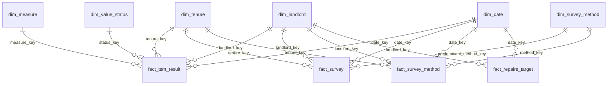

# Power BI model

The model is a star schema: six dimensions filter four fact tables. Facts
never filter each other and never filter dimensions. Every relationship is
many-to-one, single direction, from fact to dimension.

## Relationships to create

| From (many) | To (one) | Active | Notes |
|---|---|---|---|
| `fact_tsm_result[landlord_key]` | `dim_landlord[landlord_key]` | Yes | |
| `fact_tsm_result[measure_key]` | `dim_measure[measure_key]` | Yes | |
| `fact_tsm_result[tenure_key]` | `dim_tenure[tenure_key]` | Yes | |
| `fact_tsm_result[date_key]` | `dim_date[date_key]` | Yes | |
| `fact_tsm_result[status_key]` | `dim_value_status[status_key]` | Yes | |
| `fact_survey[landlord_key]` | `dim_landlord[landlord_key]` | Yes | |
| `fact_survey[tenure_key]` | `dim_tenure[tenure_key]` | Yes | |
| `fact_survey[date_key]` | `dim_date[date_key]` | Yes | |
| `fact_survey[predominant_method_key]` | `dim_survey_method[method_key]` | **No** | Inactive, so a method slicer filters `fact_survey_method` only. Use `USERELATIONSHIP` if a visual needs it. |
| `fact_survey_method[landlord_key]` | `dim_landlord[landlord_key]` | Yes | |
| `fact_survey_method[tenure_key]` | `dim_tenure[tenure_key]` | Yes | |
| `fact_survey_method[date_key]` | `dim_date[date_key]` | Yes | |
| `fact_survey_method[method_key]` | `dim_survey_method[method_key]` | Yes | |
| `fact_repairs_target[landlord_key]` | `dim_landlord[landlord_key]` | Yes | |
| `fact_repairs_target[date_key]` | `dim_date[date_key]` | Yes | |

`fact_survey_method[tp01_status_key]` is left without a relationship; it is
only read inside measures.

`data_quality_check_result` (from `outputs/data_quality/check_result.csv`)
is loaded as a standalone table with no relationships. It feeds the data
quality page only.

## Settings

- **Mark `dim_date` as a date table** on `dim_date[date]`.
- **Sort by column:** `dim_date[month_name]` by `dim_date[calendar_month]`;
  `dim_landlord[group_size_band]` by `dim_landlord[group_size_sort]`.
- **Hide** every `*_key` column in the facts, and the fact tables' raw
  `value`, `numerator` and `denominator` columns once the measures in
  [DAX_MEASURES.md](DAX_MEASURES.md) exist, so report authors use the measures.
- **Data types:** `value`, `numerator`, `denominator`, `tp01_pct_satisfied`,
  `margin_of_error_pts` and `response_rate` as Decimal; every `*_key` and
  `date_key` as Whole number; `is_usable` and the `in_*` / `flagged_*` flags as
  True/False.
- **Summarisation:** set `value` to "Don't summarize". Adding up satisfaction
  percentages across landlords gives a meaningless number, and that is the
  most common mistake with this data.

## Why these choices

The full reasoning is in [../docs/modelling_decisions.md](../docs/modelling_decisions.md).
In short: one row per published result keeps the model at RSH's own grain;
survey design, results by survey method, and repair targets are separate facts
because they describe different things at different grains; and the status of
every published cell is kept, so the report can show *why* a value is missing
rather than a blank.
